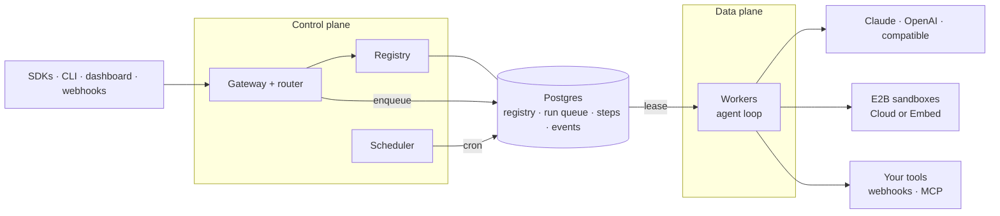

<div align="center">

# Runhive

**Run your hive of agents.**

Open-source, self-hosted platform to register, route, host and observe AI agents, on Claude or OpenAI models, with every session in its own sandbox.

[](https://github.com/khushwant04/managed-agents/actions/workflows/ci.yml)


</div>

Register an agent once. Runhive versions it, routes every request to the right version, runs it on its own durable harness against the model APIs' native features, gives each session an isolated [E2B](https://e2b.dev) sandbox, and lets you watch it all live. It runs on your own infrastructure, with E2B Cloud or a fully self-hosted [E2B Embed](https://github.com/e2b-dev/runtime) runtime.

> **Status:** v0.1 is built and tested on scripted and recorded model responses; it has not yet been run against live model APIs or released. See the [roadmap](docs/roadmap.md).

## Why Runhive

| | |
| --- | --- |
| **Register** | Agents are versioned definitions (models, instructions, tools, skills, policies) pushed from code, YAML or the API. Identical definitions are deduplicated by content hash, and movable aliases such as `prod` and `canary` point at versions. |
| **Route** | One gateway resolves `name@alias`, splits new sessions between versions by weight, falls back across models on 429s, 5xx errors and refusals, and lets agents call other agents. |
| **Host** | Deployments expose agents through HTTP, signed webhooks (GitHub, Slack, Stripe, generic), cron and queues. Sessions stream over resumable SSE or WebSocket. |
| **Run durably** | Runhive's own agent loop handles tool calls, parallel tools, steering, interrupts, approvals, subagents, compaction and budgets. Every model and tool call is a checkpointed step, so if a worker dies mid-run, another resumes the session without repeating work. |
| **Native model features** | Thin adapters for the Anthropic Messages API (adaptive thinking, prompt caching, server tools, refusal fallback), the OpenAI Responses API (reasoning effort, encrypted reasoning, native shell) and any OpenAI-compatible endpoint. |
| **Sandboxes** | Each session gets an E2B sandbox for shell, files and code, on E2B Cloud or self-hosted E2B Embed. `runhive e2b check` verifies either end to end. Docker and local providers cover development. |
| **Operate** | Encrypted secrets that never reach the model or sandbox; API keys with roles; per-project allowlists and token budgets; audit log; Prometheus metrics, OpenTelemetry traces and a Grafana dashboard. |
| **Console** | A web dashboard in the style of the Claude Console: playground, agents and aliases, deployments and webhooks, live session traces with approvals and replay, usage, keys and logs. |



## Quickstart

```bash
git clone https://github.com/khushwant04/managed-agents.git runhive && cd runhive
uv sync                                   # Python 3.11+; installs the workspace and the `runhive` CLI
export ANTHROPIC_API_KEY=...              # and/or OPENAI_API_KEY
```

**Run an agent locally** with the embedded runtime (no server):

```python
from runhive import Agent, Sandbox, tool

@tool(approval={"when": "'rm ' in args.command"})
def run_check(command: str) -> str:
    """Run a health check."""
    ...

agent = Agent(
    name="incident-investigator",
    model=["claude-opus-5-5", "gpt-6-astra"],   # primary, then fallback
    reasoning="high",
    instructions="Investigate alerts. Write findings to /workspace/outputs/report.md.",
    tools=["shell", "files", "web_search", run_check],
)
session = agent.start("5xx spike on service-api", sandbox=Sandbox.local())
for ev in session.events():
    if ev.type == "message.agent.delta":
        print(ev.text, end="")
```

**Host it** (Postgres, MinIO, gateway, workers, scheduler and the dashboard):

```bash
docker compose up -d --build              # API :8080, dashboard :3000 (sign in with ak_dev_admin)
export RUNHIVE_BASE_URL=http://localhost:8080 RUNHIVE_API_KEY=ak_dev_admin
uv run runhive apply examples/incident-investigator/agent.py --promote prod
uv run runhive deploy incident-investigator --http --cron "*/30 * * * *" --input "Check error budgets"
uv run runhive invoke incident-investigator@prod "Why did p99 latency jump?"
uv run runhive promote incident-investigator 2 --canary 10    # 10% of new sessions to v2
```

**Call it from code:**

```python
from runhive import Client

client = Client()                                       # RUNHIVE_BASE_URL, RUNHIVE_API_KEY
remote = client.invoke("incident-investigator@prod", "Why did p99 latency jump?")
for ev in remote.events():                              # same events as a local session
    ...
```

```ts
import { Client } from '@runhive/client';

const session = await new Client().invoke('incident-investigator@prod', { input: 'Triage new alerts' });
for await (const ev of session.events()) if (ev.type === 'message.agent.delta') process.stdout.write(ev.text);
```

## Deploy

Pick the shape that fits; all three run the same images.

| | Where | Sandboxes | Guide |
| --- | --- | --- | --- |
| **Local** | A laptop or VM with Docker | E2B Cloud (`E2B_API_KEY`), or Docker sandboxes on the same machine | [`docker-compose.yml`](docker-compose.yml), [`deploy/compose`](deploy/compose) |
| **Single host, fully self-hosted** | One Linux machine with KVM | **E2B Embed** on the same host; no E2B account needed | [`deploy/e2b-embed`](deploy/e2b-embed/README.md) |
| **Kubernetes** | Any cluster | E2B Cloud, or E2B Embed on KVM hosts the pods can reach | [Helm chart](deploy/helm/runhive), [plain manifests](deploy/kubernetes/README.md) |

### Single host with E2B Embed

Runhive and the E2B runtime (Firecracker microVMs) on one machine, set up by one script:

```bash
cd deploy/e2b-embed
./up.sh            # E2B Embed, generated secrets, images, the runhive-base template, the stack, an end-to-end check
$EDITOR .env       # add ANTHROPIC_API_KEY / OPENAI_API_KEY
./up.sh            # apply; safe to re-run
```

The API is then on `:8080`, the dashboard on `:3100` and E2B's own dashboard on `:3001`. The [guide](deploy/e2b-embed/README.md) covers requirements, ports, upgrades, backups and security.

### Kubernetes

```bash
helm install runhive deploy/helm/runhive -n runhive --create-namespace \
  -f deploy/helm/runhive/examples/e2b-embed-values.yaml      # or your own values
```

The chart runs the gateway (with an HPA), workers (fixed or KEDA-scaled on queue depth), the scheduler, migrations and the dashboard, plus an ingress tuned for long-lived streams. For `kubectl` without Helm, [`deploy/kubernetes/runhive-e2b-embed.yaml`](deploy/kubernetes/runhive-e2b-embed.yaml) is the chart rendered with the E2B Embed example values.

### Images

| Image | Built from | What it runs |
| --- | --- | --- |
| `ghcr.io/khushwant04/runhive-server` | [`Dockerfile`](Dockerfile) | `runhive-server serve`, `worker`, `scheduler`, `migrate`, plus the `runhive` CLI (`runhive e2b check`) |
| `ghcr.io/khushwant04/runhive-dashboard` | [`dashboard/Dockerfile`](dashboard/Dockerfile) | The web console (Next.js standalone) |
| `runhive-base` (E2B template) | [`infra/e2b/Dockerfile`](infra/e2b/Dockerfile) | The sandbox each session runs in: Ubuntu, bash, Python, Node, git |

The [release workflow](.github/workflows/release.yml) publishes both images for `linux/amd64` and `linux/arm64` on a `v*` tag. Until then, Compose builds them from source.

## The console

<p>
  
  
</p>
<p>
  
  
</p>

The dashboard never sees your API key: it lives in an httpOnly cookie on the dashboard's server, which proxies to the API. See [`dashboard/`](dashboard/README.md).

## The demo

[`examples/incident-investigator`](examples/incident-investigator/README.md) is an on-call agent run on a recorded 5xx-spike scenario with decoy deploys. It includes:

- a runbooks skill;
- tools that run in-process locally and as signed webhooks when hosted;
- a chaos demo: kill a worker mid-run and watch the session resume;
- a benchmark that runs the same incident on Claude and GPT, comparing correctness, time, tokens and cost.

## Repository layout

| Path | What |
| --- | --- |
| `packages/runhive` | Python SDK and runtime: `Agent`, `tool`, `Skill`, the runner, model adapters, sandbox providers, MCP and webhook tools, `Client` / `AsyncClient` |
| `packages/runhive-server` | Gateway (FastAPI), registry, router, run queue, workers, scheduler, secrets, metrics; the `runhive-server` command |
| `packages/runhive-cli` | The `runhive` command: `run`, `dev`, `apply`, `deploy`, `promote`, `rollback`, `invoke`, `sessions`, `secrets`, `e2b check` |
| `typescript/` | `@runhive/client` (types generated from the OpenAPI spec) and `@runhive/react` hooks |
| `dashboard/` | Next.js + shadcn/ui console |
| `examples/incident-investigator` | The flagship demo, its tools service and the benchmark |
| `docker-compose.yml`, `deploy/compose` | Local stack |
| `deploy/e2b-embed` | Runhive + E2B Embed on one host: Compose, `up.sh` / `down.sh` |
| `deploy/helm/runhive`, `deploy/kubernetes` | Helm chart (gateway HPA, KEDA-scaled workers, dashboard) and rendered manifests |
| `deploy/grafana` | Grafana dashboard |
| `infra/e2b` | The `runhive-base` sandbox template and `build_template.py` |
| `docs/` | Design plan, architecture, ADRs, API reference (`docs/api/openapi.json`) |

## Development

```bash
make install        # uv sync
make lint           # ruff
make test           # Python tests; starts a throwaway Postgres (or uses TEST_DATABASE_URL)
make test-live      # live API tests (need ANTHROPIC_API_KEY / OPENAI_API_KEY)
make openapi        # regenerate docs/api/openapi.json after API changes
make dev            # local stack with Docker Compose
make embed-stack-up # Runhive + E2B Embed on this KVM host
make k8s-manifests  # re-render deploy/kubernetes from the chart
make help           # everything else
```

The TypeScript SDK (`cd typescript && npm ci && npm test`) and the dashboard (`cd dashboard && npm ci && npm test`) have their own tests. Model calls in tests are scripted or replayed from recorded stream events, so no API keys are needed.

CI runs:
- lint and the Python tests on Postgres;
- the TypeScript and dashboard checks;
- checks that the OpenAPI spec, the generated types and the rendered manifests are current;
- the image builds;
- Helm and Compose validation.

A separate workflow ([`e2b-embed.yml`](.github/workflows/e2b-embed.yml)) boots E2B Embed and runs `runhive e2b check` against it; it needs a runner with KVM.

## Documentation

| Doc | What it covers |
| --- | --- |
| [Architecture overview](docs/architecture/overview.md) | Control plane, data plane, request path |
| [Core abstractions](docs/architecture/core-abstractions.md) | The twelve objects and the event schema |
| [Registration, routing and hosting](docs/architecture/registry-routing-hosting.md) | Registry, router, deployments, triggers |
| [Agent runtime](docs/architecture/runtime.md) | The harness: loop, checkpoints, steering, compaction |
| [Model adapters](docs/architecture/model-adapters.md) | Anthropic, OpenAI and OpenAI-compatible adapters |
| [Tools, skills and memory](docs/architecture/tools-skills-memory.md) | Where tools run, approvals, secrets, skills, memory |
| [Infrastructure](docs/architecture/infrastructure.md) | Components, data stores, sandboxes, deployment |
| [Security and operations](docs/architecture/security-operations.md) | Trust zones, tenancy, observability, cost controls |
| [E2B sandboxes](infra/e2b/README.md) | The template, E2B Cloud, E2B Embed, `runhive e2b check` |
| [Python SDK](docs/sdk/python.md) · [TypeScript SDK](docs/sdk/typescript.md) | SDKs and the CLI |
| [REST API](docs/api/rest.md) | Server REST surface (v1) |
| [Design plan](docs/design-plan.md) · [Reference designs](docs/reference-designs.md) | The original plan; Claude Managed Agents and OpenAI's Agents API compared |
| [Roadmap and risks](docs/roadmap.md) · [ADRs](docs/adr/README.md) | Phases, gates, progress; architecture decision records |

## License

Not yet chosen: Apache-2.0 is proposed in [ADR-0016](docs/adr/0016-license.md), and a `LICENSE` file will be added once it is accepted.

## Author

Built by [Khushwant Sanwalot](https://github.com/khushwant04) ([Hexel Studio](https://hexelstudio.com)).
