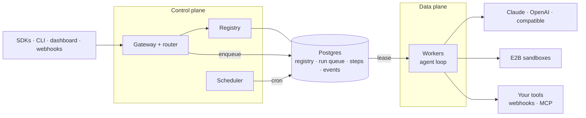
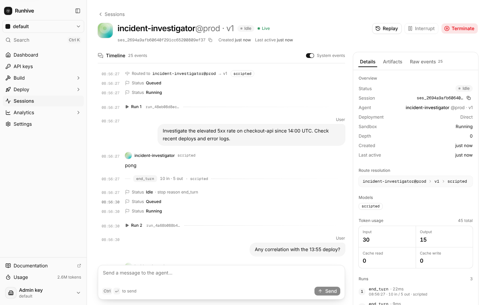

# Managed Agents

[](https://github.com/khushwant04/managed-agents/actions/workflows/ci.yml)

An open-source, self-hosted managed-agents platform. Register an agent once, and the platform hosts it, routes every request to the right agent and version, and runs it on its own harness against Claude or OpenAI models, using each model API's native features.

> **Status:** v0.1 is implemented but not yet released. Everything below is built and tested on scripted and recorded model responses. Still to do: live runs against the model APIs, the E2B template build, the package-name and license decisions ([ADR-0015](docs/adr/0015-package-and-install-names.md), [ADR-0016](docs/adr/0016-license.md)) and the first release. See the [roadmap](docs/roadmap.md).

## What it does

- **Register:** agents are versioned definitions (models, instructions, tools, skills, policies) pushed from code, YAML or the API. Identical definitions are deduplicated by content hash, and movable aliases such as `prod` and `canary` point at versions.
- **Route:** one gateway resolves `name@alias` to a version, splits new sessions between versions by weight, falls back across models on 429s, 5xx errors and refusals, and lets agents call other agents.
- **Host:** deployments expose agents through HTTP, signed webhooks (GitHub, Slack, Stripe, generic), cron and queue triggers. Sessions stream events over resumable SSE or WebSocket.
- **Run durably:** the project's own agent loop handles tool calling, parallel tools, steering, interrupts, approvals, subagents, compaction and budgets. Every model and tool call is a checkpointed step, so if a worker dies mid-run, another resumes the session without repeating completed work.
- **Use native model features:** thin adapters for the Anthropic Messages API (adaptive thinking, prompt caching, server tools, refusal fallback), the OpenAI Responses API (reasoning effort, encrypted reasoning, native shell) and any OpenAI-compatible endpoint. A session can switch vendors between runs.
- **Sandbox:** each session gets an [E2B](https://e2b.dev) sandbox for shell, files and code. Docker or a local directory can be used for development.
- **Operate:** encrypted secrets that never reach the model or the sandbox; API keys with roles; per-project allowlists and token budgets; an audit log; Prometheus metrics, OpenTelemetry traces and a Grafana dashboard.

Claude Managed Agents and OpenAI's Agents API are reference designs, not dependencies: the project only calls model inference APIs.



## Quickstart

```bash
uv sync                                   # Python 3.11+; installs the workspace
export ANTHROPIC_API_KEY=...              # and/or OPENAI_API_KEY
```

**Run an agent locally** with the embedded runtime (no server):

```python
from agents import Agent, Sandbox, tool

@tool(approval={"when": "'rm ' in args.command"})
def run_check(command: str) -> str:
    """Run a health check."""
    ...

agent = Agent(
    name="incident-investigator",
    model=["claude-opus-5-5", "gpt-6-astra"],   # primary, then fallback
    reasoning="high",
    instructions="Investigate alerts. Write findings to /workspace/outputs/report.md.",
    tools=["shell", "files", "web_search", run_check],
)
session = agent.start("5xx spike on service-api", sandbox=Sandbox.local())
for ev in session.events():
    if ev.type == "message.agent.delta":
        print(ev.text, end="")
```

**Host it** with Postgres, MinIO, a gateway, workers and a scheduler:

```bash
docker compose up -d                                   # or: make dev; or: uv run agents dev (needs Postgres)
export AGENTS_BASE_URL=http://localhost:8080 AGENTS_API_KEY=ak_dev_admin
uv run agents apply examples/incident-investigator/agent.py --promote prod
uv run agents deploy incident-investigator --http --cron "*/30 * * * *" --input "Check error budgets"
uv run agents invoke incident-investigator@prod "Why did p99 latency jump?"
uv run agents promote incident-investigator 2 --canary 10    # 10% of new sessions to v2
```

**Call it from code:**

```python
from agents import Client

client = Client()                                       # AGENTS_BASE_URL, AGENTS_API_KEY
remote = client.invoke("incident-investigator@prod", "Why did p99 latency jump?")
for ev in remote.events():                              # same events as a local session
    ...
```

```ts
import { Client } from '@managed-agents/client';

const session = await new Client().invoke('incident-investigator@prod', { input: 'Triage new alerts' });
for await (const ev of session.events()) if (ev.type === 'message.agent.delta') process.stdout.write(ev.text);
```

**Watch it** in the dashboard (`cd dashboard && npm install && npm run dev`, then sign in with your API key):



## The demo

[`examples/incident-investigator`](examples/incident-investigator/README.md) is the flagship demo. It runs an on-call agent on a recorded 5xx-spike scenario with decoy deploys. It has a runbooks skill and tools that run in-process locally and as signed webhooks when hosted. It also includes a chaos demo (kill a worker mid-run and watch the session resume) and a benchmark that runs the same incident on Claude and GPT, measuring correctness, time, tokens and cost.

## Repository layout

| Path | What |
| --- | --- |
| `packages/agents` | Python SDK and runtime: `Agent`, `tool`, `Skill`, the runner, model adapters, sandbox providers, MCP and webhook tools, `Client` / `AsyncClient` |
| `packages/agents-server` | Gateway (FastAPI), registry, router, run queue, workers, scheduler, secrets, metrics; the `agents-server` command |
| `packages/agents-cli` | The `agents` command: `run`, `dev`, `apply`, `deploy`, `promote`, `rollback`, `invoke`, `sessions`, `secrets` |
| `typescript/` | `@managed-agents/client` (types generated from the OpenAPI spec) and `@managed-agents/react` hooks |
| `dashboard/` | Next.js dashboard: agents, versions and aliases, deployments, live session timelines with approvals and replay, usage, audit |
| `examples/incident-investigator` | The flagship demo, its tools service and the benchmark |
| `docker-compose.yml`, `Dockerfile`, `deploy/compose` | Local stack and server image |
| `deploy/helm`, `deploy/grafana` | Helm chart (HPA gateway, KEDA-scaled workers) and Grafana dashboard |
| `infra/e2b` | The `agents-base` sandbox template |
| `docs/` | Design plan, architecture, ADRs, API reference (`docs/api/openapi.json`) |

## Development

```bash
make install        # uv sync
make lint           # ruff
make test           # Python tests; starts a throwaway Postgres (or uses TEST_DATABASE_URL)
make test-live      # live API tests (need ANTHROPIC_API_KEY / OPENAI_API_KEY)
make openapi        # regenerate docs/api/openapi.json after API changes
make dev            # local stack with Docker Compose
make help           # everything else
```

The TypeScript SDK (`cd typescript && npm ci && npm test`) and the dashboard (`cd dashboard && npm ci && npm test`) have their own tests. Model calls in tests are scripted or replayed from recorded stream events, so no API keys are needed. CI runs lint, the Python tests on Postgres, the TypeScript and dashboard checks, a check that the OpenAPI spec and generated types are current, image builds, and Helm and Compose validation.

## Documentation

| Doc | What it covers |
| --- | --- |
| [Design plan](docs/design-plan.md) | The full SDK and infrastructure plan this repo is built from |
| [Architecture overview](docs/architecture/overview.md) | Control plane, data plane, request path |
| [Core abstractions](docs/architecture/core-abstractions.md) | The twelve objects and the event schema |
| [Registration, routing and hosting](docs/architecture/registry-routing-hosting.md) | Registry, router, deployments, triggers |
| [Agent runtime](docs/architecture/runtime.md) | The harness: loop, checkpoints, steering, compaction |
| [Model adapters](docs/architecture/model-adapters.md) | Anthropic, OpenAI and OpenAI-compatible adapters |
| [Tools, skills and memory](docs/architecture/tools-skills-memory.md) | Where tools run, approvals, secrets, skills, memory |
| [Infrastructure](docs/architecture/infrastructure.md) | Components, data stores, sandboxes, deployment |
| [Security and operations](docs/architecture/security-operations.md) | Trust zones, tenancy, observability, cost controls |
| [Python SDK](docs/sdk/python.md) · [TypeScript SDK](docs/sdk/typescript.md) | SDKs and the CLI |
| [REST API](docs/api/rest.md) | Server REST surface (v1) |
| [Reference designs](docs/reference-designs.md) | Claude Managed Agents and OpenAI Agents API compared |
| [Roadmap and risks](docs/roadmap.md) | Phases, gates, progress, risks, open questions |
| [ADRs](docs/adr/README.md) | Architecture decision records |

## License

The plan proposes Apache-2.0; the choice is still open in [ADR-0016](docs/adr/0016-license.md). A `LICENSE` file will be added once it is accepted.

## Author

Built by [Khushwant Sanwalot](https://github.com/khushwant04) ([Hexel Studio](https://hexelstudio.com)).
