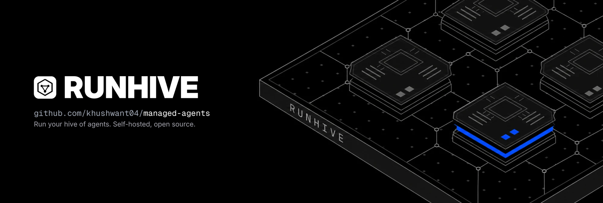

<div align="center">



A self-hosted platform to register, route, host and observe AI agents on Claude and OpenAI models, with every session in its own sandbox.

[](https://github.com/khushwant04/managed-agents/actions/workflows/ci.yml)


[Quickstart](#quickstart) · [Deploy](#deploy) · [Docs](#documentation) · [Roadmap](docs/roadmap.md)

</div>

---

Define an agent in Python, YAML or over the API, and Runhive takes it from there:

- it **versions** the agent;
- it **routes** each request to the right version;
- it **runs** the agent on its own durable harness, using each model API's native features;
- it gives every session an isolated **[E2B](https://e2b.dev) sandbox**;
- it **streams** everything live to the SDKs, the CLI and the web console.

Runhive runs entirely on your infrastructure, with E2B Cloud or a self-hosted **[E2B Embed](https://github.com/e2b-dev/runtime)** runtime.

> [!NOTE]
> v0.1 is built and tested on scripted and recorded model responses, but has not yet been run against live model APIs or released. Progress is tracked in the [roadmap](docs/roadmap.md).

## Features

**Agents and routing**
- Versioned agent definitions (models, instructions, tools, skills, policies), deduplicated by content hash.
- Movable aliases (`prod`, `canary`) with weighted traffic splits and one-step rollback.
- `name@alias` routing, model fallback on 429s, 5xx errors and refusals, and agents calling agents.

**Durable runtime**
- Runhive's own agent loop: tool calls, parallel tools, steering, interrupts, approvals, subagents, compaction and budgets.
- Every model and tool call is a checkpointed step. If a worker dies mid-run, another resumes the session without repeating work.
- Native adapters for the Anthropic Messages API, the OpenAI Responses API and any OpenAI-compatible endpoint.

**Hosting**
- Deployments with HTTP, signed webhook (GitHub, Slack, Stripe, generic), cron and queue triggers.
- Resumable SSE and WebSocket event streams.
- One E2B sandbox per session for shell, files and code; Docker and local providers for development.

**Operations**
- Encrypted secrets that never reach the model or the sandbox.
- API keys with roles, per-project allowlists and token budgets, and an audit log.
- Prometheus metrics, OpenTelemetry traces and a Grafana dashboard.
- A web console with a playground, live session traces, approvals and replay.

## How it works


The gateway resolves `name@alias` and enqueues a run in Postgres. A worker leases it, drives the model and tools step by step, and checkpoints each step. Events stream back to every client. [Architecture overview →](docs/architecture/overview.md)

## Quickstart

```bash
git clone https://github.com/khushwant04/managed-agents.git runhive && cd runhive
uv sync                                    # Python 3.11+; installs the SDK, server and `runhive` CLI
export ANTHROPIC_API_KEY=...               # and/or OPENAI_API_KEY
```

### 1. Run an agent locally

No server needed; the embedded runtime runs the same loop as the platform.

```python
from runhive import Agent, Sandbox, tool

@tool(approval={"when": "'rm ' in args.command"})
def run_check(command: str) -> str:
    """Run a health check."""
    ...

agent = Agent(
    name="incident-investigator",
    model=["claude-opus-5-5", "gpt-6-astra"],   # primary, then fallback
    reasoning="high",
    instructions="Investigate alerts. Write findings to /workspace/outputs/report.md.",
    tools=["shell", "files", "web_search", run_check],
)

session = agent.start("5xx spike on service-api", sandbox=Sandbox.local())
for ev in session.events():
    if ev.type == "message.agent.delta":
        print(ev.text, end="")
```

### 2. Host it

```bash
docker compose up -d --build               # API :8080 · console :3000 (key: ak_dev_admin)
export RUNHIVE_BASE_URL=http://localhost:8080 RUNHIVE_API_KEY=ak_dev_admin

uv run runhive apply examples/incident-investigator/agent.py --promote prod
uv run runhive deploy incident-investigator --http --cron "*/30 * * * *" --input "Check error budgets"
uv run runhive invoke incident-investigator@prod "Why did p99 latency jump?"
uv run runhive promote incident-investigator 2 --canary 10    # 10% of new sessions to v2
```

### 3. Call it from code

```python
from runhive import Client

client = Client()                                       # RUNHIVE_BASE_URL, RUNHIVE_API_KEY
remote = client.invoke("incident-investigator@prod", "Why did p99 latency jump?")
for ev in remote.events():                              # same events as a local session
    ...
```

```ts
import { Client } from '@runhive/client';

const session = await new Client().invoke('incident-investigator@prod', { input: 'Triage new alerts' });
for await (const ev of session.events()) if (ev.type === 'message.agent.delta') process.stdout.write(ev.text);
```

## Deploy

All three options run the same images.

| Option | Runs on | Sandboxes | Start here |
| --- | --- | --- | --- |
| **Local** | Any machine with Docker | E2B Cloud, or Docker sandboxes | [`docker-compose.yml`](docker-compose.yml) |
| **Single host, fully self-hosted** | One Linux machine with KVM | E2B Embed on the same host; no E2B account | [`deploy/e2b-embed`](deploy/e2b-embed/README.md) |
| **Kubernetes** | Any cluster | E2B Cloud, or E2B Embed on reachable KVM hosts | [Helm chart](deploy/helm/runhive) · [manifests](deploy/kubernetes/README.md) |

<details open>
<summary><b>Single host with E2B Embed</b></summary>

<br>

Runhive and the E2B runtime (Firecracker microVMs) on one machine:

```bash
cd deploy/e2b-embed
./up.sh            # E2B Embed → secrets → images → runhive-base template → stack → end-to-end check
$EDITOR .env       # add ANTHROPIC_API_KEY and/or OPENAI_API_KEY
./up.sh            # safe to re-run
```

API on `:8080`, console on `:3100`, E2B's dashboard on `:3001`. The [guide](deploy/e2b-embed/README.md) covers requirements, ports, upgrades, backups and security.

</details>

<details>
<summary><b>Kubernetes</b></summary>

<br>

```bash
helm install runhive deploy/helm/runhive -n runhive --create-namespace \
  -f deploy/helm/runhive/examples/e2b-embed-values.yaml      # or your own values
```

The chart runs:
- the gateway, with an HPA;
- workers, fixed or KEDA-scaled on queue depth;
- the scheduler, migrations and the console;
- an ingress tuned for long-lived streams.

Without Helm, apply [`deploy/kubernetes/runhive-e2b-embed.yaml`](deploy/kubernetes/runhive-e2b-embed.yaml), the chart rendered with the E2B Embed example values.

</details>

### Images

| Image | Built from | Runs |
| --- | --- | --- |
| `ghcr.io/khushwant04/runhive-server` | [`Dockerfile`](Dockerfile) | Gateway, workers, scheduler, migrations and the `runhive` CLI |
| `ghcr.io/khushwant04/runhive-dashboard` | [`dashboard/Dockerfile`](dashboard/Dockerfile) | The web console |
| `runhive-base` E2B template | [`infra/e2b/Dockerfile`](infra/e2b/Dockerfile) | Each session's sandbox: Ubuntu, bash, Python, Node, git |

The [release workflow](.github/workflows/release.yml) publishes the two container images for `linux/amd64` and `linux/arm64` on a `v*` tag. Until the first release, Compose builds them from source.

## Packages

| Package | Install | What it is |
| --- | --- | --- |
| [`runhive`](packages/runhive) | `pip install runhive` | Python SDK and runtime: `Agent`, `tool`, `Skill`, adapters, sandbox providers, `Client` |
| [`runhive-server`](packages/runhive-server) | `pip install runhive-server` | Gateway, registry, router, run queue, workers, scheduler; the `runhive-server` command |
| [`runhive-cli`](packages/runhive-cli) | `pip install runhive-cli` | The `runhive` command: `run`, `dev`, `apply`, `deploy`, `promote`, `rollback`, `invoke`, `sessions`, `secrets`, `e2b check` |
| [`@runhive/client`](typescript/packages/client) | `npm i @runhive/client` | TypeScript client, typed from the OpenAPI spec |
| [`@runhive/react`](typescript/packages/react) | `npm i @runhive/react` | React hooks: `useSession`, `useEvents` |
| [Console](dashboard/README.md) | Docker image | Next.js + shadcn/ui web console |

None of these are on PyPI or npm yet; until the first release, install from this repository with `uv sync` and `npm ci`.

## Example

[`examples/incident-investigator`](examples/incident-investigator/README.md) is an on-call agent that triages a recorded 5xx spike with decoy deploys. It includes:

- a runbooks skill;
- tools that run in-process locally and as signed webhooks when hosted;
- a chaos demo: kill a worker mid-run and watch the session resume;
- a Claude vs GPT benchmark comparing correctness, time, tokens and cost.

## Development

```bash
make install         # uv sync
make lint            # ruff
make test            # Python tests on a throwaway Postgres (or TEST_DATABASE_URL)
make test-live       # live model API tests (needs provider keys)
make dev             # local stack with Docker Compose
make embed-stack-up  # Runhive + E2B Embed on this KVM host
make openapi         # regenerate docs/api/openapi.json after API changes
make k8s-manifests   # re-render deploy/kubernetes from the Helm chart
make help            # everything else
```

The TypeScript SDK (`cd typescript && npm ci && npm test`) and the console (`cd dashboard && npm ci && npm test`) have their own suites. Tests replay scripted or recorded model responses, so they need no API keys.

CI checks:
- lint and the Python tests on Postgres;
- the TypeScript and console suites;
- that the OpenAPI spec, generated types and rendered manifests are current;
- the image builds, and the Helm and Compose configs.

<details>
<summary><b>Repository layout</b></summary>

<br>

| Path | What |
| --- | --- |
| `packages/runhive` · `runhive-server` · `runhive-cli` | Python SDK and runtime · server · CLI |
| `typescript/` | `@runhive/client` and `@runhive/react` |
| `dashboard/` | The web console |
| `examples/incident-investigator` | Flagship demo, tools service, benchmark |
| `docker-compose.yml`, `deploy/compose` | Local stack |
| `deploy/e2b-embed` | Runhive + E2B Embed on one host |
| `deploy/helm/runhive`, `deploy/kubernetes` | Helm chart and rendered manifests |
| `deploy/grafana` | Grafana dashboard |
| `infra/e2b` | The `runhive-base` sandbox template |
| `docs/` | Architecture, SDKs, REST API, ADRs, roadmap |

</details>

## Documentation

| Topic | Docs |
| --- | --- |
| Architecture | [Overview](docs/architecture/overview.md) · [Core abstractions](docs/architecture/core-abstractions.md) · [Registry, routing and hosting](docs/architecture/registry-routing-hosting.md) · [Runtime](docs/architecture/runtime.md) · [Model adapters](docs/architecture/model-adapters.md) · [Tools, skills and memory](docs/architecture/tools-skills-memory.md) |
| Operations | [Infrastructure](docs/architecture/infrastructure.md) · [Security and operations](docs/architecture/security-operations.md) · [E2B sandboxes](infra/e2b/README.md) |
| SDKs and API | [Python SDK and CLI](docs/sdk/python.md) · [TypeScript SDK](docs/sdk/typescript.md) · [REST API](docs/api/rest.md) · [OpenAPI spec](docs/api/openapi.json) |
| Project | [Design plan](docs/design-plan.md) · [Reference designs](docs/reference-designs.md) · [Roadmap](docs/roadmap.md) · [ADRs](docs/adr/README.md) |

## License

Not yet chosen. Apache-2.0 is proposed in [ADR-0016](docs/adr/0016-license.md); a `LICENSE` file follows once it is accepted.

## Author

Built by [Khushwant Sanwalot](https://github.com/khushwant04) · [Hexel Studio](https://hexelstudio.com)
