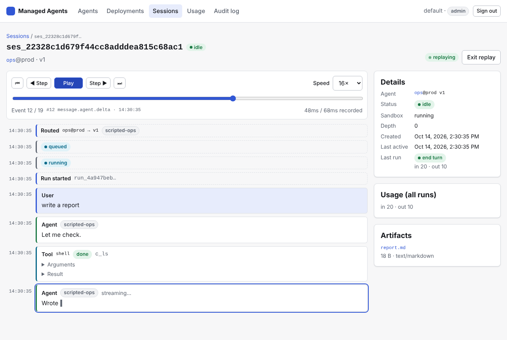
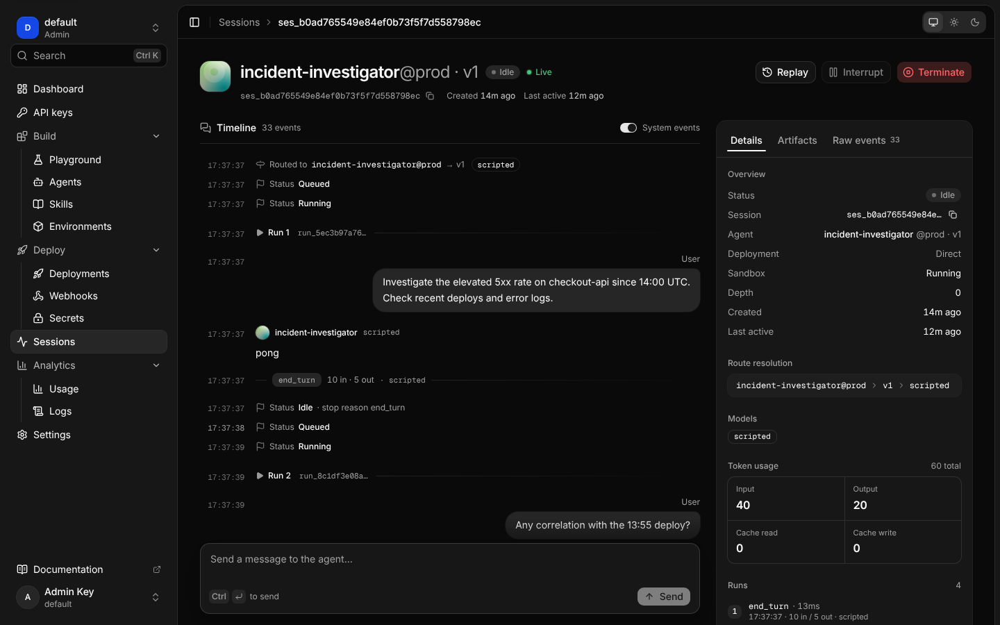

# Managed Agents dashboard

A small Next.js (App Router) app for operating a Managed Agents server. It covers agents, versions and aliases, deployments, session timelines with live streaming and replay, usage, and the audit log. It talks to the REST API ([`docs/api/rest.md`](../docs/api/rest.md), [`openapi.json`](../docs/api/openapi.json)) and has no other backend.


## Pages

| Page | What it does |
| --- | --- |
| **Sign in** | Paste a project API key. The key is checked with `GET /v1/project`. The server is `AGENTS_API_URL`, or another server from `AGENTS_API_URL_ALLOWLIST` when that is set. |
| **Agents** | Searches agents (`GET /v1/agents?q=`). |
| **Agent detail** | Versions table, showing which aliases serve each version and how much traffic each gets. Aliases with a weight bar. View a version's spec JSON. **Promote** a version to an alias, set a **canary split** (stable version, canary version and percent), and **roll back** an alias. Every alias move goes through a confirm dialog that shows the target before and after. |
| **Deployments** | Lists deployments. The detail view shows triggers (cron, webhook, queue, http), concurrency, status, budget, secrets, and the webhook URL with a copy button. **Pause** and **Resume** use `PATCH {status}` with a confirm dialog. |
| **Sessions** | Lists sessions, filterable by agent and limit. Links to parent and child sessions. |
| **Session timeline** | Loads history from `GET /v1/sessions/{id}/events`, then follows `GET /v1/sessions/{id}/stream?after=<last seq>` over SSE, reconnecting with backoff from the last seq. It renders route, status and run events, user messages, and agent text (deltas joined into one message per run turn, with thinking collapsible). It also shows tool calls with their results (collapsible, errors highlighted), approvals with **Approve / Deny** and an optional reason, subagent links, artifacts with download links, and per-run usage. There is a message box (`message.user`) and **Interrupt**. |
| **Replay** | For a settled session: step, scrub, play and pause through the recorded events at 0.5× to 16×. Gaps come from the recorded timestamps; idle gaps longer than 1.5s are compressed. |
| **Usage** | `GET /v1/usage?days=`: totals, a stacked inline-SVG bar chart of input and output tokens per day, and a table by day and model. |
| **Audit log** | `GET /v1/audit` (admin keys only). Other keys get a friendly "Admins only" message instead of an error. |

<p>
  
  
</p>

## How auth works

The browser never sees the API key.

1. `POST /api/auth/signin` (a route handler) validates the key against `GET {upstream}/v1/project`. It then stores the key in an **httpOnly, SameSite=Strict** cookie, which is `Secure` when the request came over HTTPS (`X-Forwarded-Proto` is honoured). The project name and role go in a second cookie for the header.
2. Pages call only `/api/proxy/v1/...`. The proxy route adds `Authorization: Bearer <key>` and forwards to the upstream:
   - Only `/v1/...` paths are proxied. Dot segments and anything else get a 404.
   - Only a short allowlist of request headers is forwarded (`accept`, `content-type`, `last-event-id`, `if-none-match`), and the same goes for response headers.
   - Non-GET requests must be same-origin (`Origin` must match the host), on top of SameSite cookies.
   - Bodies are **streamed, not buffered**. For `text/event-stream` the proxy sets `Cache-Control: no-cache, no-transform` (which keeps Next's gzip from buffering) and `X-Accel-Buffering: no`. It also sends an SSE comment first, because Next only flushes response headers with the first body chunk and a quiet stream would otherwise wait for the server's 15s keepalive. When the browser disconnects, the upstream request is aborted.
3. A 401 from the proxy sends the browser back to `/signin?expired=1`.

The upstream can only ever be `AGENTS_API_URL` or an entry in `AGENTS_API_URL_ALLOWLIST`. The proxy re-checks this on every request, so the dashboard can't be pointed at arbitrary hosts.

## Configuration

| Variable | Default | Meaning |
| --- | --- | --- |
| `AGENTS_API_URL` | `http://localhost:8080` | The Managed Agents API to proxy to. |
| `AGENTS_API_URL_ALLOWLIST` | (empty) | Comma-separated extra API URLs offered at sign-in. |
| `DASHBOARD_INSECURE_COOKIES` | (unset) | `1` drops the cookie `Secure` flag even over HTTPS. Use it only when debugging behind a proxy that doesn't send `X-Forwarded-Proto`. |
| `PORT` / `HOSTNAME` | `3000` / `0.0.0.0` (image) | Where the standalone server listens. |

## Development

Node 22.12 or later.

```bash
cd dashboard
npm install
npm run generate      # lib/api-types.ts from ../docs/api/openapi.json (openapi-typescript)
npm run dev           # http://localhost:3000, AGENTS_API_URL=http://localhost:8080 by default
```

| Script | |
| --- | --- |
| `npm run generate` | Regenerate `lib/api-types.ts` after the OpenAPI spec changes. The file is committed, so builds don't need the spec. |
| `npm run lint` | ESLint (flat config, `eslint-config-next` core-web-vitals + TypeScript). |
| `npm run typecheck` | `tsc --noEmit`. |
| `npm test` | Vitest unit tests for the pure logic in `lib/`. |
| `npm run build` / `npm start` | Production build (`output: "standalone"`) and server. |

To try it without real model keys, start a server with a scripted model. `packages/agents-server/tests/test_api.py` shows how to wire `Services` + `create_app` + a worker with `ScriptedAdapter` against a throwaway Postgres. Then bootstrap an admin key and sign in with it.

### Layout

```text
app/
  api/auth/{signin,signout}/route.ts   cookie session
  api/proxy/[...path]/route.ts         authenticated, streaming proxy to the API
  signin/                              sign-in form
  (dash)/                              signed-in shell (redirects to /signin without a session)
    agents/ deployments/ sessions/ usage/ audit/
    sessions/[id]/use-session-events.ts  history + SSE follow with reconnect
components/                            UI primitives, <dialog>-based modals, useApi hook
lib/
  api-types.ts    generated from the OpenAPI spec (do not edit)
  api.ts          named aliases for the generated schema types
  sse.ts          incremental SSE parser (+ tests)
  timeline.ts     event log → timeline view model reducer (+ tests)
  replay.ts       replay cursor/speed/timing reducer (+ tests)
  alias.ts        promote / canary split / validation helpers (+ tests)
  usage.ts        per-day rollups and axis helpers (+ tests)
  proxy.ts        upstream allowlist, path mapping, header filtering, origin check (+ tests)
  client.ts       browser fetch helper (through the proxy) and error messages
```

The timeline reducer, `lib/timeline.ts`, works like this:

- Deltas are joined per run until `message.agent.done` (its text wins) or a tool call.
- Tool calls and results are matched by call id, as are approval requests and decisions, and subagent starts and finishes by child session.
- Events at or below the last applied `seq` are dropped, so history and the live stream can overlap safely.
- `applyEvent` is immutable (React state) and `buildTimeline` folds a whole log with a mutable draft.

Replay steps forward incrementally and rebuilds only when seeking backwards.

## Docker

```bash
docker build -t managed-agents-dashboard dashboard
docker run --rm -p 3000:3000 -e AGENTS_API_URL=http://gateway:8080 managed-agents-dashboard
```

The image runs `node server.js` from Next's standalone output as the unprivileged `node` user. Put it behind your ingress with TLS, and with long read timeouts so session streams stay open.

## Theming and accessibility

There is one global stylesheet (`app/globals.css`) using CSS variables, with light and dark themes chosen by `prefers-color-scheme`:



Accessibility features:

- Semantic tables, labelled form controls and visible focus rings.
- A skip link, and native `<dialog>` for modals (focus trap and Escape handled by the browser).
- `aria-live` for the connection state and notices.
- `prefers-reduced-motion` is respected.

The chart's two series colours were checked for colour-blind separation and contrast in both themes. The chart has a legend and a keyboard-focusable per-day readout, and the same data is in a table under the chart. Layouts reflow down to phone width.
