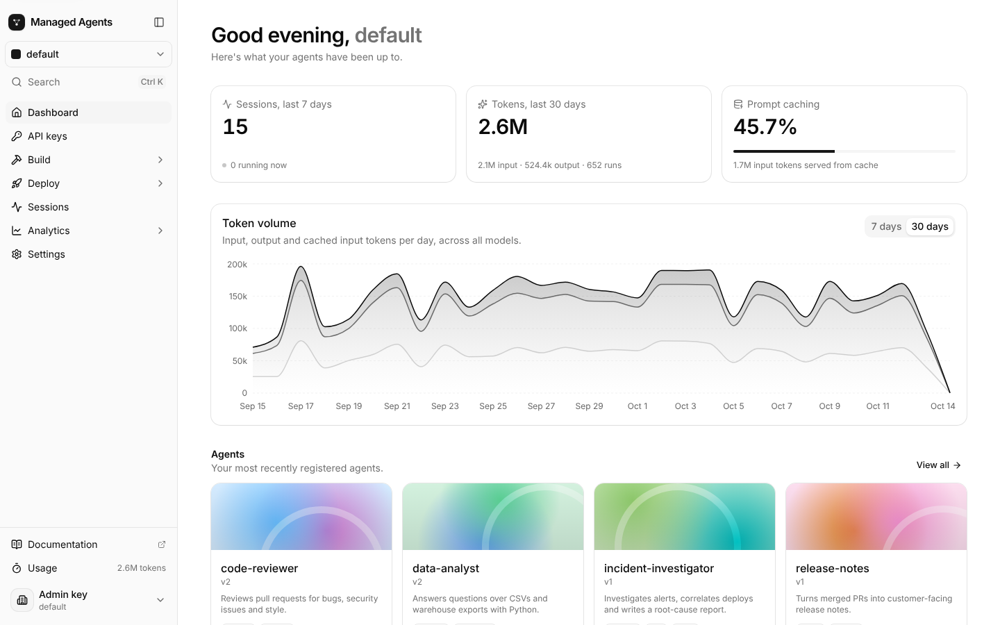
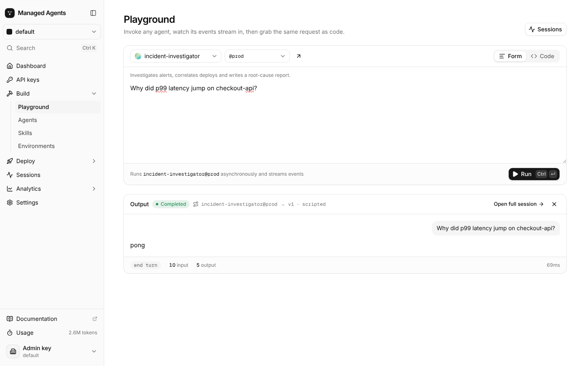
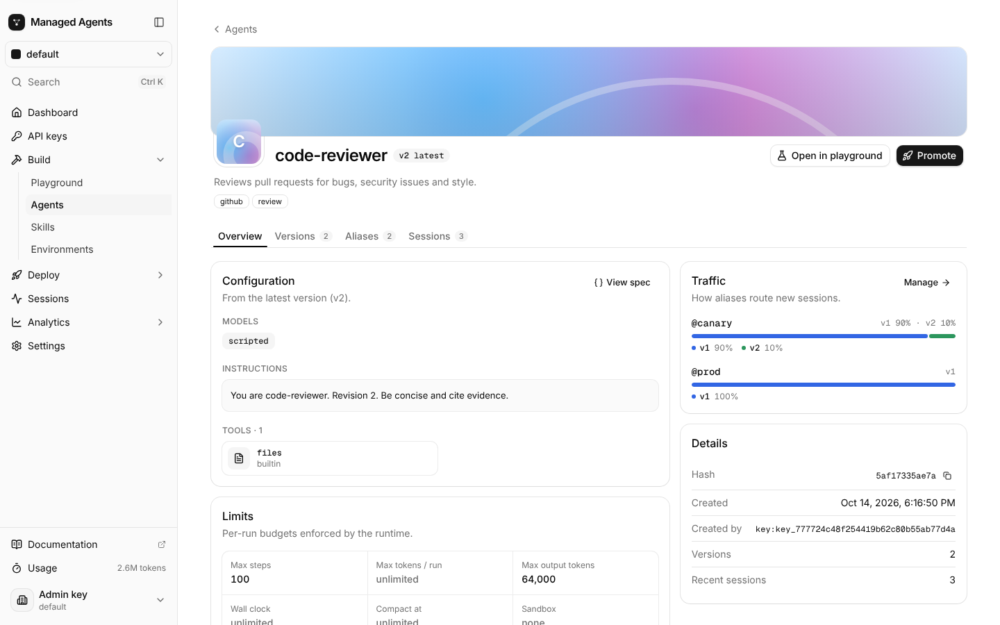
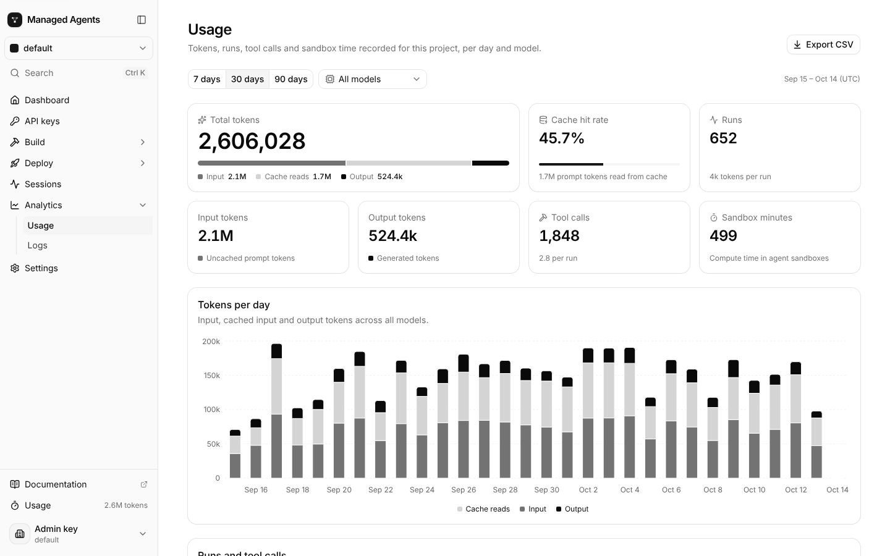
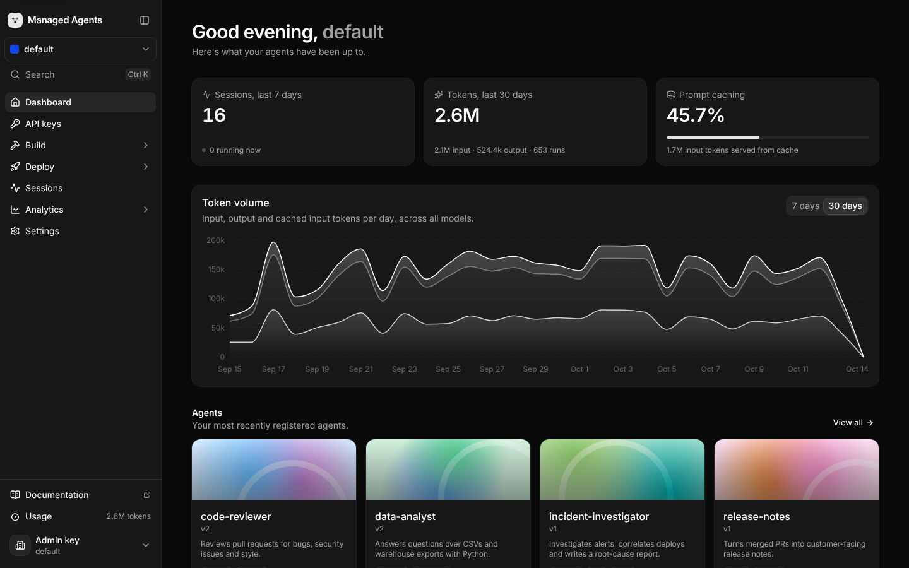

# Managed Agents dashboard

The web console for a Managed Agents server, in the style of the Claude Console and the OpenAI platform. Use it to register and version agents, try them in a playground, deploy them behind HTTP, webhooks, cron and queues, follow sessions live, and keep an eye on usage, keys and audit logs. It talks only to the REST API ([`docs/api/rest.md`](../docs/api/rest.md), [`openapi.json`](../docs/api/openapi.json)).



It is a Next.js 16 App Router app scaffolded with `npx shadcn@latest init --preset b0 --template next`: shadcn/ui on [Base UI](https://base-ui.com), Tailwind CSS v4, `next-themes`, [Motion](https://motion.dev) and Recharts.

## Pages

| Page | What it does |
| --- | --- |
| **Sign in** | Paste a project API key; it is checked with `GET /v1/project`. The server is `AGENTS_API_URL`, or one picked from `AGENTS_API_URL_ALLOWLIST`. |
| **Dashboard** | Greeting, sessions this week, token volume and prompt-cache share with count-up numbers, a 7/30-day token chart, the latest agents as artwork cards, recent sessions and quick starts. |
| **API keys** | Create keys (shown once), list and revoke them (from the audit log), and copy cURL, Python and TypeScript snippets for this server. |
| **Playground** | Pick an agent and alias, write the input and run it with Ctrl/⌘+Enter; output streams in over SSE with tool calls and token usage. **Code** shows the same request as cURL, Python or TypeScript. Six templates register a starter agent in one click. |
| **Agents** | Grid or table, with search. Register an agent from a JSON spec; validation problems show inline. |
| **Agent detail** | Overview (models, instructions, tools, limits, alias traffic), versions with each spec, aliases with weight bars, and **promote**, **canary split** and **rollback** dialogs that preview the change. |
| **Skills** | Skill bundles; upload a `.zip` or `.tar.gz` by drag and drop. Zips are repacked into the tar.gz the server expects. |
| **Environments** | Sandbox environments (E2B, Docker, local) with limits, internet access and allowed hosts; create and edit. |
| **Deployments** | Trigger chips (cron in plain English), a create dialog with a trigger builder, environment, secrets and budget. The detail page has pause/resume, delete, invoke now, a sync/async/stream cURL block and recent sessions. |
| **Webhooks** | Every webhook endpoint with its URL. **Add webhook endpoint** creates a webhook deployment and reveals its URL and signing secret once. A per-provider "How signing works" card covers GitHub, Slack, Stripe and generic. |
| **Secrets** | Write-only secrets: add, rotate, delete. |
| **Sessions** | Filter by agent, status and id (kept in the URL), auto-refresh, subagent and deployment links. |
| **Session** | The live trace. History is loaded from `/events`, then `/stream?after=<seq>` is followed over SSE with reconnect. The timeline shows messages, thinking, tool calls with arguments, results and durations, approvals with **Approve / Deny**, subagents, artifacts, errors and per-run usage. A side panel has details, artifacts and raw events. There is a composer for steering, plus **Interrupt**, **Terminate** and **Replay** (step, scrub, 0.5×–16×). |
| **Usage** | 7/30/90 days and a model filter: totals, stacked tokens per day, runs and tool calls, a per-model breakdown and CSV export. |
| **Logs** | The audit log with actions coloured by verb, expandable details, filters and live refresh (admin keys). |
| **Settings** | General project details, appearance (system, light, dark), the project policy editor with a key reference (admins), and sign-out. |

<p>
  
  
</p>
<p>
  
  
</p>

## Design

- **Theme.** `app/globals.css` keeps the neutral oklch tokens from the shadcn `neutral` base colour for `:root` and `.dark` (radius `0.625rem`; the dark sidebar accent is `oklch(0.488 0.243 264.376)`). Next to them are easing curves (`--ease-out-quint`, `--ease-spring`), depth (`shadow-card`, `shadow-elevated`, `shadow-dialog`) and three status hues (`success`, `warning`, `info`) for badges and timeline markers.
- **Motion.** The shadcn primitives in `components/ui` are tuned for motion:
  - menus, popovers, selects and dialogs ease in from a slight offset;
  - tabs slide their indicator;
  - buttons press-scale;
  - switches spring;
  - skeletons shimmer;
  - the sidebar collapses on an ease-out curve.

  Pages fade in through `app/(console)/template.tsx`. `components/motion.tsx` has `FadeIn`, `Stagger`, `AnimatedNumber` and `Expand`. The sidebar's active item is a pill that glides between links, and theme switches reveal as a circle from the click (View Transitions). Everything honours `prefers-reduced-motion`.
- **Shell.** A full-height sidebar laid out like the Claude Console:
  - a brand row with its own collapse toggle (Ctrl/⌘+B);
  - a compact project switcher;
  - Ctrl/⌘+K search across pages, agents and actions;
  - sections with chevrons that unfold around the current page;
  - a footer with docs, 30-day token usage and the signed-in key.

  Collapsed to icons, each section becomes one icon that opens a flyout of its pages. There is no header on desktop: detail pages carry a back link, and the theme switch lives in the account menu and Settings. On phones a slim bar opens the sidebar.



## How auth works

The browser never sees the API key.

1. **Sign in.** `POST /api/auth/signin` validates the key against `GET {upstream}/v1/project`.
   - The key is stored in an **httpOnly, SameSite=Strict** cookie, `Secure` over HTTPS (`X-Forwarded-Proto` is honoured).
   - The project name and role go in a second cookie for the shell.
2. **Proxy.** Pages call only `/api/proxy/v1/...`, which adds `Authorization: Bearer <key>` and forwards to the upstream.
   - Only `/v1/...` paths are proxied.
   - A short header allowlist applies in both directions.
   - Non-GET requests must be same-origin.
   - Bodies are streamed. For SSE the proxy disables buffering and sends a comment first so headers flush immediately.
3. **Expiry.** A 401 sends the browser back to `/signin?expired=1`.

The upstream can only be `AGENTS_API_URL` or an entry in `AGENTS_API_URL_ALLOWLIST`, re-checked on every request.

## Configuration

| Variable | Default | Meaning |
| --- | --- | --- |
| `AGENTS_API_URL` | `http://localhost:8080` | The Managed Agents API to proxy to. |
| `AGENTS_API_URL_ALLOWLIST` | (empty) | Comma-separated extra API URLs offered at sign-in. |
| `DASHBOARD_INSECURE_COOKIES` | (unset) | `1` drops the cookie `Secure` flag even over HTTPS; only for debugging behind a proxy without `X-Forwarded-Proto`. |
| `PORT` / `HOSTNAME` | `3000` / `0.0.0.0` (image) | Where the standalone server listens. |

## Development

Node 22.12 or later.

```bash
cd dashboard
npm install
npm run dev           # http://localhost:3000, AGENTS_API_URL=http://localhost:8080 by default
```

| Script | |
| --- | --- |
| `npm run generate` | Regenerate `lib/api-types.ts` from `../docs/api/openapi.json` (committed, so builds don't need the spec). |
| `npm run lint` | ESLint (`eslint-config-next` core-web-vitals + TypeScript, including the React compiler rules). |
| `npm run typecheck` | `tsc --noEmit`. |
| `npm test` | Vitest unit tests for the pure logic in `lib/`. |
| `npm run build` | Production build (`output: "standalone"`). |
| `npm run format` | Prettier with the Tailwind plugin. |

Add shadcn components with `npx shadcn@latest add <name>`. They land in `components/ui` and use Base UI, so compose them with the `render` prop rather than `asChild`.

To try it without model keys, run the throwaway server the TypeScript integration tests use. It starts its own Postgres, bootstraps the key `ak_it_admin` and registers a model `scripted` that answers "pong":

```bash
.venv/bin/python typescript/scripts/it-server.py --port 8765 &
AGENTS_API_URL=http://127.0.0.1:8765 npm --prefix dashboard run dev
```

### Layout

```text
app/
  api/auth/{signin,signout}/route.ts   cookie session
  api/proxy/[...path]/route.ts         authenticated, streaming proxy to the API
  signin/                              sign-in page
  (console)/                           signed-in console (redirects to /signin without a session)
    layout.tsx template.tsx            shell and page transitions
    page.tsx home-view.tsx             dashboard home
    agents/ playground/ skills/ environments/ deployments/ webhooks/ secrets/
    sessions/ usage/ logs/ api-keys/ settings/
components/
  ui/          shadcn components (base-nova), tuned for motion
  shell/       sidebar, command menu, header, project context
  agents/ playground/ session/ deploy/ analytics/ settings/   per-area components
  motion.tsx page.tsx states.tsx status-badge.tsx code-block.tsx copy-button.tsx agent-art.tsx …
hooks/         useApi/useMutation, useIsMobile, useHydrated/useNow
lib/
  api-types.ts generated from the OpenAPI spec (do not edit); api.ts names its types
  client.ts    browser fetch helper (through the proxy) and error messages
  proxy.ts     upstream allowlist, path mapping, header filtering, origin check
  sse.ts timeline.ts replay.ts alias.ts usage.ts session-view.ts usage-report.ts
  cron.ts triggers.ts skill-bundle.ts keys.ts policy.ts format.ts   pure, unit-tested logic
```

## Docker

```bash
docker build -t managed-agents-dashboard dashboard
docker run --rm -p 3000:3000 -e AGENTS_API_URL=http://gateway:8080 managed-agents-dashboard
```

The image runs `node server.js` from Next's standalone output as the unprivileged `node` user. Put it behind your ingress with TLS and long read timeouts so session streams stay open. The build downloads the Inter and Geist Mono fonts through `next/font`, so it needs network access.

## Accessibility

- Base UI primitives give dialogs, menus, selects and tabs their focus management and ARIA.
- There is a skip link, visible focus rings and labelled controls.
- The theme follows the system unless you choose light or dark.
- Animations are disabled under `prefers-reduced-motion`.
- Layouts reflow to phone width; tables scroll inside their cards.
