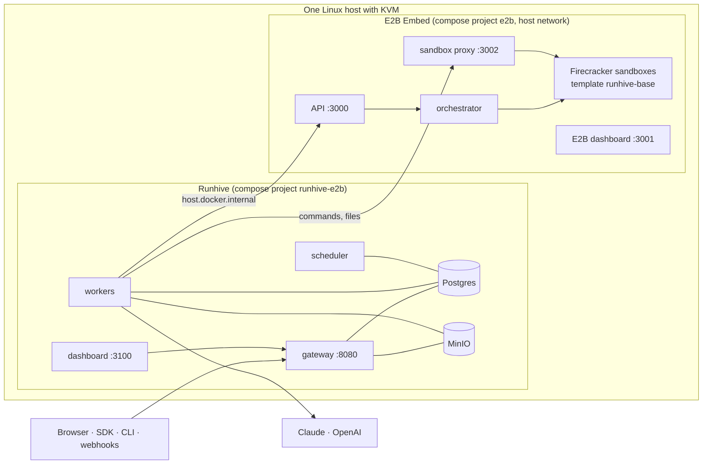

# Runhive + E2B Embed on one host

Run the whole platform, model calls aside, on a single Linux machine: Runhive's API, workers, scheduler and dashboard, plus a self-hosted E2B runtime ([E2B Embed](https://github.com/e2b-dev/runtime)) that runs every session's sandbox as a Firecracker microVM. No E2B Cloud account is needed.



## Requirements

The host must satisfy E2B Embed's requirements ([details](https://github.com/e2b-dev/runtime/tree/main/embed/compose#requirements)):

- Linux x86-64 or arm64 with KVM (`/dev/kvm`). That means bare metal, or a VM with nested virtualisation.
- 16 GiB RAM or more: Embed recommends 12 GiB for itself, and Runhive adds about 2 GiB. Also 30 GiB free disk.
- Docker Engine with the Compose plugin, plus `curl`.
- At least one model key: `ANTHROPIC_API_KEY` or `OPENAI_API_KEY`.

## Start

```bash
git clone https://github.com/khushwant04/managed-agents.git runhive && cd runhive/deploy/e2b-embed
./up.sh                         # first run takes a few minutes
$EDITOR .env                    # add ANTHROPIC_API_KEY and/or OPENAI_API_KEY, then:
./up.sh
```

`up.sh` is safe to re-run. It does, in order:

1. **E2B Embed:** downloads Embed's `compose.yaml` and `.env` at the commit pinned in `E2B_EMBED_REF` into `./embed/`. Then it runs `docker compose up -d --wait`, which prepares the host (kernel modules, hugepages), fetches Firecracker, migrates Embed's databases and builds Embed's `base` template.
2. **Settings:** creates `.env` from `.env.example`. It generates the Postgres and MinIO passwords, `RUNHIVE_MASTER_KEY` and an admin key `RUNHIVE_BOOTSTRAP_KEY`. It copies Embed's team API key into `E2B_API_KEY`. Values already in `.env` are kept.
3. **Images:** builds `runhive-server` and `runhive-dashboard` from this checkout, or pulls published images with `--pull`.
4. **Sandbox template:** builds `runhive-base` (Ubuntu, bash, Python, Node, git; [infra/e2b](../../infra/e2b)) on Embed, unless it already exists.
5. **Runhive:** starts Postgres, MinIO, migrations, the gateway, a worker, the scheduler and the dashboard.
6. **Check:** runs `runhive e2b check` from the workers' network. This creates a sandbox, checks `/workspace`, the toolchain, the built-in shell, files and code tools, and pause and resume, then destroys the sandbox.

Then:

| What | Where |
| --- | --- |
| API | `http://<host>:8080` (`RUNHIVE_PUBLIC_URL`) |
| Dashboard | `http://<host>:3100`. Sign in with `RUNHIVE_BOOTSTRAP_KEY` from `.env` |
| E2B dashboard | `http://<host>:3001`, with the key from `E2B_API_KEY` |

```bash
export RUNHIVE_BASE_URL=http://<host>:8080
export RUNHIVE_API_KEY=$(grep ^RUNHIVE_BOOTSTRAP_KEY= .env | cut -d= -f2-)
cd ../.. && uv run runhive apply examples/incident-investigator/agent.py --promote prod
uv run runhive invoke incident-investigator@prod "Why did p99 latency jump?"
```

Options: `./up.sh --skip-embed` (Embed is already running on this host), `--pull`, `--rebuild-template`, `--skip-check`.

## What runs where

| Service | Image | Network | Published |
| --- | --- | --- | --- |
| gateway | `runhive-server` | `runhive-e2b` bridge | `:8080` |
| worker (scale with `docker compose up -d --scale worker=3`) | `runhive-server` | bridge, plus `host.docker.internal` for Embed | none |
| scheduler, migrate | `runhive-server` | bridge | none |
| dashboard | `runhive-dashboard` | bridge | `:3100` |
| postgres, minio | `postgres:16-alpine`, `pgsty/minio` | bridge | MinIO console on `127.0.0.1:9101` only |
| template, check (one-shot, profile `tools`) | `runhive-server` | host (template), bridge (check) | none |
| E2B Embed (about 20 services) | Embed's pinned images | host | `:3000`, `:3001`, `:3002`, plus internal ports on `127.0.0.1` |

Embed holds 3000–3003, 3010, 5432, 6379, 8123, 9000 and others on this host. So Runhive keeps its own Postgres and MinIO off the host ports and serves the dashboard on 3100.

### Images

| Image | Built from | Published as (release workflow) |
| --- | --- | --- |
| Server: gateway, worker, scheduler, migrations and the `runhive` CLI | [`Dockerfile`](../../Dockerfile) | `ghcr.io/khushwant04/runhive-server:<version>` |
| Dashboard | [`dashboard/Dockerfile`](../../dashboard/Dockerfile) | `ghcr.io/khushwant04/runhive-dashboard:<version>` |
| Sandbox template `runhive-base` | [`infra/e2b/Dockerfile`](../../infra/e2b/Dockerfile) | built into each E2B install (`up.sh` step 4) |

To use published images, set `RUNHIVE_IMAGE` and `RUNHIVE_DASHBOARD_IMAGE` in `.env` and run `./up.sh --pull`.

## Operate

```bash
docker compose ps                                # Runhive services
docker compose logs -f worker                    # session runs, sandbox calls
docker compose up -d --scale worker=3            # more workers (each runs RUNHIVE_WORKER_CONCURRENCY runs)
docker compose --profile tools run --rm check    # re-check the E2B path
docker compose -p e2b --project-directory embed -f embed/compose.yaml ps    # Embed services
./down.sh                                        # stop Runhive; ./down.sh --embed also stops Embed
```

**Upgrade Runhive:** `git pull && ./up.sh`. Migrations run on start.

**Upgrade Embed:** set a new `E2B_EMBED_REF` (a commit of e2b-dev/runtime) and run `./up.sh`. Your previous Embed `.env` is kept as `embed/.env.previous`; copy any custom settings over, such as `HUGEPAGES` or `E2B_DASHBOARD_HOST`.

**Backups:** two volumes hold Runhive's data, `runhive-e2b_postgres-data` (registry, sessions, events, secrets) and `runhive-e2b_minio-data` (artifacts, skills, snapshots). Back them up along with `RUNHIVE_MASTER_KEY`, without which stored secrets can't be decrypted.

**Remove everything:** `./down.sh --purge` deletes both stacks' volumes and undoes Embed's host setup.

## Security

- Embed's API, dashboard and sandbox proxy (3000–3002) authenticate only with the team key. Only trusted clients should reach them; Embed's README covers [ports and tunnels](https://github.com/e2b-dev/runtime/tree/main/embed/compose#ports).
- Put TLS in front of 8080 and 3100 (a reverse proxy such as Caddy or nginx) before exposing them. Set `RUNHIVE_PUBLIC_URL` to the HTTPS address. Set `GATEWAY_BIND=127.0.0.1` and `DASHBOARD_BIND=127.0.0.1` when the proxy runs on the same host.
- `.env` holds every secret and is created with mode 600. Keep it out of version control; it is git-ignored.
- Rotate `RUNHIVE_BOOTSTRAP_KEY` once you have created your own keys on the dashboard's API keys page.

## Kubernetes

Embed needs a KVM host and runs on the host network, so it stays a Compose install on one or more KVM machines. Runhive itself can run in Kubernetes and point at Embed:

- Helm: [`deploy/helm/runhive/examples/e2b-embed-values.yaml`](../helm/runhive/examples/e2b-embed-values.yaml).
- Plain manifests: [`deploy/kubernetes`](../kubernetes).

## Troubleshooting

- **Embed's `up` fails.** Embed names the failing step and a `FIX:` line. Its [troubleshooting guide](https://github.com/e2b-dev/runtime/tree/main/embed/compose#troubleshooting) covers KVM, nbd and hugepages. Fix the cause and re-run `./up.sh`.
- **The check can't reach `host.docker.internal:3000`.** A host firewall, such as ufw, is dropping traffic from the Docker bridge to the host. Allow it (`sudo ufw allow in on docker0`), or set `E2B_HOST=<this host's LAN IP>` in `.env` and re-run `./up.sh`.
- **The template build fails.** Run `./up.sh --rebuild-template`. Embed's API and orchestrator logs name the template-manager error: `docker compose -p e2b --project-directory embed -f embed/compose.yaml logs api orchestrator`.
- **Sessions fail with "no model provider".** Add `ANTHROPIC_API_KEY` or `OPENAI_API_KEY` to `.env` and run `./up.sh` again.
