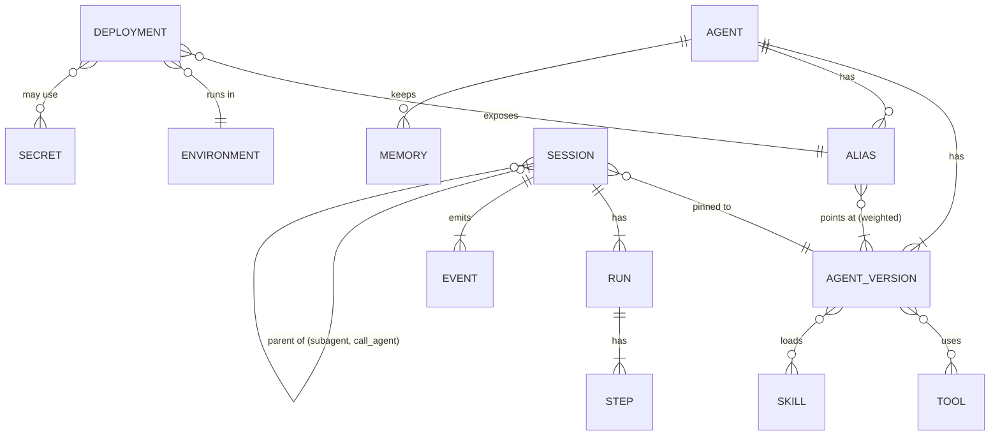
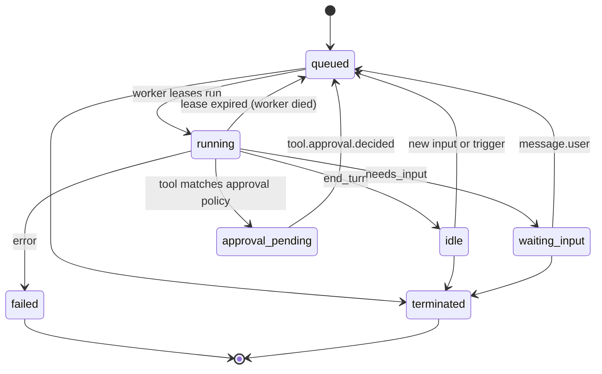

# Core abstractions

Twelve objects in three groups: what is **registered**, what is **hosted**, and what **runs**. The shape follows the Agent / Environment / Session / Event model both [reference designs](../reference-designs.md) converged on, extended with a registry and hosting layer.

| Group | Object | What it is | Key fields |
| --- | --- | --- | --- |
| Registered | `Agent` | Named definition with an immutable version per change | name, version, model list, instructions, tools, skills, policies |
| Registered | `Alias` | Movable pointer to one or more versions | `prod`, `canary`, version weights |
| Registered | `Tool` | Function (webhook or sandbox script), MCP server, built-in, or another agent | schema, approval policy, secret refs |
| Registered | `Skill` | Versioned folder of instructions and scripts | path, version, description |
| Registered | `Environment` | Sandbox template | provider (`e2b`, `docker`), template, limits |
| Hosted | `Deployment` | An alias made reachable | triggers (http, webhook, cron, queue), concurrency, environment, secrets |
| Hosted | `Secret` | Encrypted credential injected at tool time | name, scope, rotation |
| Runs | `Session` | One conversation or task with its history and sandbox | agent version, status, lease, sandbox id |
| Runs | `Run` | One turn of work started by an input or trigger | steps, usage, stop reason |
| Runs | `Step` | One model call or tool call; the checkpoint unit | type, input, output, status, idempotency key |
| Runs | `Event` | Normalized message on the session stream | seq, type, payload |
| Runs | `Memory` | Files an agent keeps across sessions | store id, path |

## Relationships



- A session is pinned to one agent version for its life; traffic splits only affect new sessions ([ADR-0007](../adr/0007-routing-model.md)).
- A run is one turn; a session has many runs. The model may change between runs ([ADR-0011](../adr/0011-runtime-owns-the-transcript.md)).
- Steps are the checkpoint unit ([ADR-0005](../adr/0005-durable-execution-on-postgres.md)).

## Session status



Statuses: `queued`, `running`, `waiting_input`, `approval_pending`, `idle`, `failed`, `terminated`. Run stop reasons: `end_turn`, `needs_input`, `approval_pending`, `budget`, `error`.

## Event schema

Every event carries:

| Field | Meaning |
| --- | --- |
| `id` | Unique event ID |
| `session_id` | Owning session |
| `run_id` | Run that produced it (if any) |
| `seq` | Monotonic per session; used for `Last-Event-ID` replay |
| `type` | One of the types below |
| `ts` | Timestamp |
| `model` | Model that produced it, when applicable |
| `payload` | Type-specific body |

Core types:

| Type | Payload |
| --- | --- |
| `session.status` | queued, running, waiting_input, approval_pending, idle, failed, terminated |
| `route.resolved` | alias, chosen version, chosen model |
| `run.started`, `run.finished` | stop reason, usage |
| `message.user` | user input |
| `message.agent.delta`, `message.agent.done` | streamed and final agent text |
| `thinking.delta` | reasoning text, when the model exposes it |
| `tool.call`, `tool.result` | tool name, arguments, result |
| `tool.approval.requested`, `tool.approval.decided` | call, decision |
| `subagent.started`, `subagent.finished` | child session |
| `artifact.created` | output file reference |
| `error` | error details |

`seq` lets any client reconnect with `Last-Event-ID` and replay from the log ([ADR-0008](../adr/0008-event-log-and-streaming.md)).

Example:

```json
{
  "id": "evt_01J...",
  "session_id": "ses_01J...",
  "run_id": "run_01J...",
  "seq": 42,
  "type": "route.resolved",
  "ts": "2026-10-14T09:30:12.418Z",
  "model": "claude-opus-5-5",
  "payload": { "alias": "prod", "version": 14, "model": "claude-opus-5-5" }
}
```
