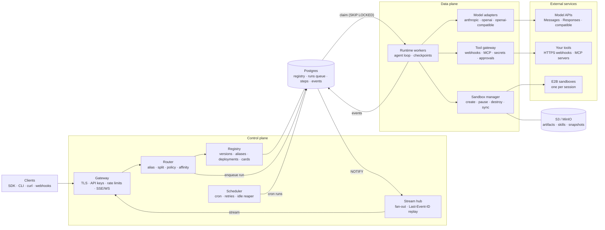
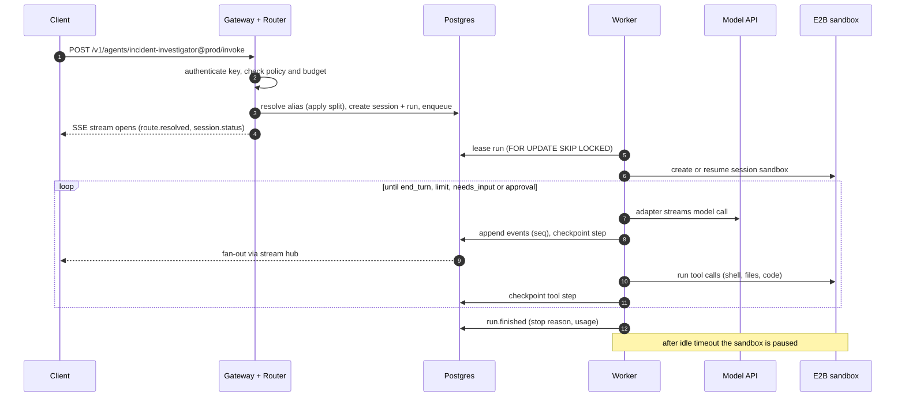

# Architecture overview

Two planes the project owns, plus three things it calls out to: your tools, E2B sandboxes and model APIs.

- The **control plane** decides *what* runs: which agent, which version, which deployment.
- The **data plane** decides *how* it runs: the loop, tools, sandbox, model.
- The **Postgres run queue** between them is what makes sessions durable: any worker can pick up any run from its last checkpoint ([ADR-0005](../adr/0005-durable-execution-on-postgres.md)).

## Diagram

## Components

| Component | Plane | Responsibility |
| --- | --- | --- |
| Gateway | Control | TLS, API keys, rate limits, SSE/WebSocket termination |
| Registry | Control | Versions, aliases, deployments, agent cards, validation |
| Router | Control | Alias resolution, traffic split, affinity, enqueue runs |
| Scheduler | Control | Cron triggers, retries, idle reaper, usage rollup |
| Stream hub | Control | Fan-out events with `Last-Event-ID` replay |
| Runtime workers | Data | Execute runs step by step; call model adapters; drive tools |
| Tool gateway | Data | Webhook tools, MCP client, secret injection, approvals, egress rules |
| Sandbox manager | Data | Create, pause, resume and destroy sandboxes; file sync; timeouts |
| Dashboard | — | Agents, versions, deployments, session timelines |

Details and v1 shapes: [Infrastructure](infrastructure.md).

## Request path

1. Client calls `POST /v1/agents/incident-investigator@prod/invoke`.
2. Gateway authenticates the key and checks project policy and budget.
3. Router resolves the alias (applying any split), creates the session and run, and enqueues it.
4. A worker leases the run, loads the agent version, and creates or resumes the session's sandbox.
5. The loop runs: the adapter streams the model, events are appended with `seq` and fanned out to the client, tools execute in the sandbox or tool gateway, and each step is checkpointed.
6. The run ends with a stop reason; after the idle timeout the sandbox is paused.

## Where to go next

- [Core abstractions](core-abstractions.md): the objects that flow through this picture.
- [Registration, routing and hosting](registry-routing-hosting.md): the control plane in depth.
- [Agent runtime](runtime.md): the data plane's loop.
