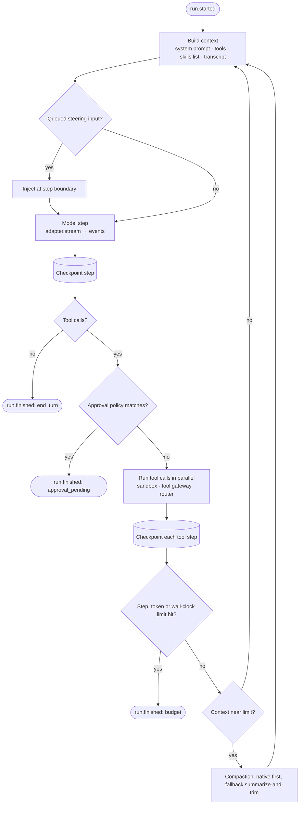

# Agent runtime: our own harness

The runtime is a step machine: build context, call the model, run the tools it asks for, append the results, and repeat until the model ends its turn, a limit is hit, or it needs input or approval. The same runtime runs embedded in a script and inside hosted workers (principle 7).

Decision records: [ADR-0002](../adr/0002-own-the-harness-inference-apis-only.md), [ADR-0005](../adr/0005-durable-execution-on-postgres.md), [ADR-0011](../adr/0011-runtime-owns-the-transcript.md).



## Behaviors

- **Loop:** parallel tool calls when the model emits several; per-run limits on steps, tokens and wall-clock; typed stop reasons (`end_turn`, `needs_input`, `approval_pending`, `budget`, `error`).
- **Checkpoints:** each step is written to Postgres before and after execution, with an idempotency key, so a resumed run never repeats a completed tool call.
- **Streaming:** text, thinking and tool progress become events as they arrive.
- **Steering and interrupt:** input sent mid-run is queued and injected at the next step boundary; interrupt cancels the in-flight model call and marks the run.
- **Context management:** native first (Claude's server-side compaction and context editing, OpenAI's compaction); our summarize-and-trim fallback for other models. Prompt order stays cache-friendly: stable system prompt and tools first.
- **Subagents:** a `spawn_subagent` tool starts a child session with its own context and a reduced tool set; its final answer returns as a tool result, with a concurrency cap.
- **Approvals:** tool calls matching a policy pause the run until an approval event arrives ([ADR-0014](../adr/0014-tool-approvals-as-policy.md)).
- **Replay:** every model response is stored per step, so any session can be replayed offline for debugging and tests.

## Resume after a crash

1. Worker A leases run R and heartbeats the lease.
2. Worker A completes steps 1 to 4, then dies during step 5 (`begun`, not `completed`).
3. The lease expires. Worker B claims R and reads `last_completed(R)` = step 4.
4. Worker B rebuilds context from the stored transcript and re-executes step 5. If step 5 was a webhook tool call, it reuses the same idempotency key, so the receiver can deduplicate.
5. A `session.status` event records the takeover; the "sessions resumed after worker failure" metric increments.

This path is exercised by a CI chaos test that kills workers mid-run.

## Core interfaces

```python
class ModelAdapter(Protocol):
    id: Literal["anthropic", "openai", "openai-compatible"]
    def capabilities(self, model: str) -> CapabilityManifest: ...
    def stream(self, req: ModelRequest) -> AsyncIterator[ModelDelta]: ...  # text, thinking, tool_call, usage

class SandboxProvider(Protocol):
    async def create(self, env: Environment) -> SandboxHandle: ...
    async def exec(self, h: SandboxHandle, cmd: str, timeout: float | None = None) -> ExecResult: ...
    async def write_files(self, h: SandboxHandle, files: list[FileSpec]) -> None: ...
    async def read_files(self, h: SandboxHandle, paths: list[str]) -> list[FileSpec]: ...
    async def pause(self, h: SandboxHandle) -> None: ...      # optional
    async def destroy(self, h: SandboxHandle) -> None: ...

class StepStore(Protocol):  # Postgres in v1; Temporal or Restate could slot in later
    async def begin(self, step: StepSpec) -> StepId: ...
    async def complete(self, step_id: StepId, output: Any) -> None: ...
    async def last_completed(self, run_id: str) -> Step | None: ...
```

See [Model adapters](model-adapters.md) and [Infrastructure](infrastructure.md#sandboxes-on-e2b) for the implementations behind these.
