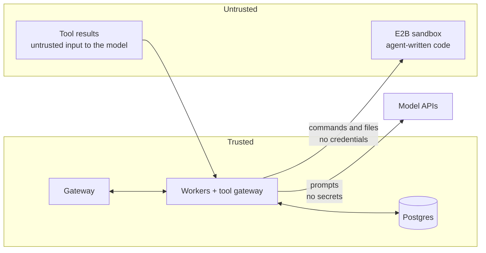

# Security, multi-tenancy, observability and cost

Sandboxes are the untrusted zone: model provider keys and secrets stay in the control and data planes and never reach agent-written code or model context.

## Trust zones

## Security and tenancy

- **Trust zones:** gateway and workers are trusted; sandboxes run untrusted agent code; tool results are untrusted input to the model.
- **Provider keys:** bring-your-own Anthropic and OpenAI keys per project, encrypted, used only by workers.
- **Sandbox isolation:** one E2B sandbox (a Firecracker microVM) per session, never shared across tenants, with a hard timeout, no platform credentials, and network access restricted where the provider allows it ([ADR-0006](../adr/0006-e2b-sandbox-per-session.md)).
- **Tenant model:** `org → project → API key`, RBAC roles (admin, developer, viewer), and per-project allowlists for models, tools, egress domains and which agents may call which.
- **Prompt-injection hygiene:** approvals on high-risk tools, egress allowlists, and a depth limit on `call_agent` chains.
- **Secrets:** encrypted, referenced by name, injected only at the tool gateway ([ADR-0010](../adr/0010-secrets-handling.md)).
- **Data posture:** sessions, transcripts and files live in your Postgres and storage; only model calls leave. With ZDR-eligible features and accounts, vendors retain nothing; the adapter flags features that are not ZDR-eligible.
- **Audit log:** registrations, alias moves, deployments, sessions, tool calls, approvals and secret reads.

## Observability

- **Traces:** OpenTelemetry with a span per run, step and tool call, using the GenAI semantic conventions; agent version and resolved route on every span.
- **Metrics (Prometheus):** queue depth, time to first token, run latency, tool error rate, provider 429 and 5xx rates, cache hit rate, cost per run, sessions resumed after worker failure.
- **Timeline and replay:** a session timeline and replay viewer in the dashboard, built from the event log and recorded responses.

## Cost controls

- Usage recorded per step: input, output and cached tokens per model, sandbox seconds, tool calls.
- Budgets per project, deployment and session; max steps and wall-clock per run; automatic stop with a `budget` stop reason.
- Model tiers and fallbacks let cheap models take easy runs.
- No billing in core; usage is exposed through the API and Prometheus for anyone who wants to charge on top.
