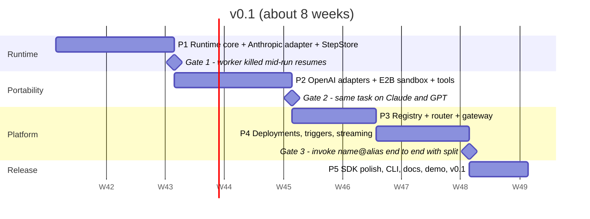

# Roadmap, risks and open questions

Ship v0.1 with the Python SDK in about eight weeks: registry, router, runtime with both adapters, E2B sandboxes and the Python SDK. Each phase ends on a gate that proves the riskiest assumption first.

## Progress (2026-10-15)

| Phase | State |
| --- | --- |
| 1. Runtime core | Done. Gate 1 passes in CI: `test_worker_killed_mid_run_is_resumed_by_another` |
| 2. Portability | Done: Anthropic, OpenAI and OpenAI-compatible adapters, E2B/Docker/local sandboxes, MCP and webhook tools. Gate 2 (same task on Claude and GPT) needs a live run of `examples/incident-investigator/benchmark.py` |
| 3. Registry and router | Done |
| 4. Hosting | Done. Gate 3 is covered by the API tests (routing through weighted aliases, deployments, triggers) |
| 5. Release | Built: Python client, CLI, Compose, Dockerfiles, CI, demo and benchmark; named Runhive (ADR-0015). Remaining: live runs with API keys, E2B template build, ADR-0016 license, reserving the PyPI and npm names, PyPI publish |
| After v0.1 | Built ahead of schedule: TypeScript client and React hooks, dashboard (redesigned on shadcn/ui in the style of the Claude Console), Helm chart with KEDA, OpenTelemetry spans |

## Phases and gates

> The plan's roadmap diagram (5 phases, 3 gates) was not included in the exported document. The breakdown below is reconstructed from the plan's v0.1 scope and risks; adjust it if the original differs.

| Phase | Weeks | Scope | Ends on |
| --- | --- | --- | --- |
| 1. Runtime core | 1–2 | Step machine, `StepStore` on Postgres, run queue with leases, `anthropic` adapter, event log, recorded-response test fixtures | **Gate 1:** chaos test kills a worker mid-run and the session resumes without repeating a completed tool call |
| 2. Portability | 3–4 | `openai` and `openai-compatible` adapters, capability manifests, E2B and Docker sandbox providers, portable built-in tools, webhook and MCP tools | **Gate 2:** the same agent definition completes the same task on Claude and GPT |
| 3. Registry and router | 5–6 | Content-hashed versions, aliases with weights, agent cards, gateway auth and policy, alias cache with `NOTIFY`, model fallbacks | — |
| 4. Hosting | 6–7 | Deployments, HTTP/webhook/cron triggers, SSE with `Last-Event-ID`, steering, interrupt, approvals | **Gate 3:** `incident-investigator@prod` invoked end to end through the router, with a 90/10 split behaving as configured |
| 5. Release | 8 | Python SDK polish, `runhive-cli`, `docker compose up`, docs, flagship demo, PyPI publish | v0.1 |

**After v0.1 (weeks 9 to 12):** the TypeScript SDK, the dashboard, the Helm chart with KEDA autoscaling, subagents, and OpenTelemetry dashboards.

## What makes it resume-ready

- A README GIF of an agent being registered, deployed and invoked by `name@alias`.
- A chaos demo that kills a worker mid-run and shows the session resume.
- A benchmark of the same task on Claude and GPT (time, tokens, cost).
- 80%+ test coverage on the runtime.
- A short design write-up.

## Risks

| Risk | Impact | Mitigation |
| --- | --- | --- |
| Model APIs differ and change (thinking blocks, tool formats, caching rules) | Adapter bugs, broken sessions | Contract tests on recorded responses per adapter; nightly live tests; pinned vendor SDKs |
| Durable execution is subtle (double tool calls, stuck leases) | Lost or duplicated work | Idempotency keys, lease heartbeats, a CI chaos test that kills workers |
| The plan's placeholder name `agents` is already used: npm `agents` is Cloudflare's Agents SDK, and the Python module `agents` is what OpenAI's Agents SDK installs | Install conflicts, confused users | Resolved: everything is named Runhive ([ADR-0015](adr/0015-package-and-install-names.md)) |
| E2B costs and limits on long sessions | Surprise bills, killed sessions | Hard timeouts, pause or snapshot when idle, Docker provider for dev |
| Registry, router, runtime and hosting is a lot for one person | Nothing ships | Hold the non-goals; dashboard and TypeScript SDK only after v0.1 |

## Open questions

Each is tracked as a Proposed ADR with a recommendation.

- [x] Install names: a fresh namespace, **Runhive**, for every package, import and command → [ADR-0015](adr/0015-package-and-install-names.md)
- [ ] License: Apache-2.0 (patent grant) or MIT (simplest)? → [ADR-0016](adr/0016-license.md)
- [ ] Durable execution: plain Postgres queue in v0.1, or adopt Temporal or Restate from day one? → [ADR-0005](adr/0005-durable-execution-on-postgres.md)
- [ ] Flagship demo: incident investigator or a GitHub issue fixer? → [ADR-0017](adr/0017-flagship-demo.md)

## Goals and non-goals for v1

**Goals**

- Register, version and alias agents; deploy them behind HTTP, webhook and cron triggers.
- Route by `name@alias`, with weighted traffic splits, session affinity and model fallbacks.
- Own harness: tool loop, streaming, steering, interrupt, compaction, subagents, approvals.
- Adapters for the Anthropic Messages API, the OpenAI Responses API and OpenAI-compatible servers.
- One E2B sandbox per session; sessions survive worker restarts.
- `docker compose up` locally, a Helm chart for Kubernetes, and CI on recorded model responses.

**Non-goals**

- A visual agent builder.
- Training, fine-tuning or hosting model weights (call APIs or OpenAI-compatible servers such as vLLM).
- Billing, payments or a hosted SaaS.
